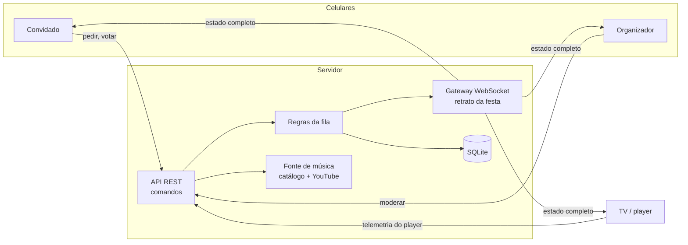

<p align="center">
  <picture>
    <source media="(prefers-color-scheme: dark)" srcset="assets/logo-escuro.svg">
    
  </picture>
</p>

<p align="center">
  Jukebox colaborativa para festas: a TV toca, os convidados pedem e votam pelo celular.
</p>

<p align="center">
  
  
  
  
  
  
</p>

---

## O problema

Toda festa em casa tem a mesma cena:

- **Um celular vira refém da caixa de som.** Quem quer pedir uma música precisa pegar o aparelho do dono, desbloquear, procurar e devolver. O celular passa de mão em mão a noite toda.
- **Uma pessoa vira DJ sem querer.** Quem está com o celular decide tudo, e o resto da festa fica pedindo "coloca aquela depois".
- **Não tem onde ver o que está tocando.** A TV da sala fica desligada enquanto a música sai de uma tela de 6 polegadas que ninguém enxerga.
- **Ninguém sabe o que vem depois.** Os pedidos se perdem, alguém pede a mesma música duas vezes e quem chegou cedo nunca ouve a sua.

## A solução

O Vitrolinha transforma a TV da casa em uma jukebox que a festa inteira controla.

1. **A TV mostra um QR code.** Basta abrir o navegador da TV (ou de um notebook ou celular ligado na caixa de som).
2. **Quem escaneia primeiro vira o organizador.** Sem cadastro: só um apelido.
3. **Os convidados escaneiam e pedem músicas** pelo próprio celular, buscando por nome, artista ou colando um link.
4. **Todo mundo vota** nas músicas da fila, e a fila se reorganiza na hora, na TV e em todos os celulares.

Ninguém precisa instalar nada, criar conta ou entregar o celular para ninguém.

<!--
## Telas

<p align="center">
  
  &nbsp;
  
</p>
-->

## Funcionalidades

| Para os convidados | Para o organizador | Na TV |
|---|---|---|
| Entrar com um apelido, sem login | Pular a música atual | Player em destaque, sem nada por cima |
| Buscar por nome, artista ou link | Remover pedidos da fila | Próximas músicas e quem pediu |
| Votar nos pedidos dos outros | Definir uma playlist padrão para a fila vazia | QR sempre visível para quem chegar |
| Acompanhar a posição dos próprios pedidos | Passar o comando para outra pessoa por QR | Pula sozinha vídeos com erro ou travados |
| | Histórico do que tocou e encerramento da festa | Retoma de onde parou se a internet cair |

## Uma fila justa

O ponto central do projeto é a regra de ordenação. Cada pedido recebe uma pontuação:

```
pontuação = votos − (músicas que a pessoa já emplacou) + (tempo esperando ÷ 15 min)
```

- **Votos contam**, então a festa decide o que toca primeiro.
- **Quem já tocou bastante cede a vez**, então ninguém monopoliza a noite.
- **Quem espera ganha prioridade com o tempo**, então todo pedido toca, mesmo sem votos.
- **A mesma pessoa nunca toca duas seguidas** quando há pedido de outra.
- A mesma música não repete dentro de 30 minutos, e cada pessoa tem um limite de pedidos na fila.

## Arquitetura



- **O servidor é a fonte da verdade.** A TV é um player sem regra nenhuma: só toca o que o servidor manda e informa o que está acontecendo.
- **Comandos por REST, estado por WebSocket.** A cada mudança, cada aparelho recebe um retrato completo da festa, filtrado pelo papel dele (o organizador vê mais que o convidado). Quem reconecta recebe tudo de novo e nunca fica dessincronizado.
- **Coalescência de mensagens.** Numa rajada de votos, o servidor junta as mudanças e envia no máximo um retrato a cada 150 ms por festa.
- **Eventos idempotentes.** Todo evento do player leva o identificador da música. Um "terminou" atrasado ou repetido não pula a música seguinte.
- **Fonte de música isolada.** Nenhuma parte do sistema fora do módulo de música conhece o YouTube. Trocar por outra fonte não mexe na fila, nos votos nem nas telas.
- **Economia de cota.** A busca consulta primeiro o catálogo da própria festa e um cache, e só depois a API externa, com limites por festa e por pessoa.

## Tecnologias

| Camada | Tecnologias |
|---|---|
| Linguagem | TypeScript em modo estrito, ponta a ponta |
| Contrato | Pacote compartilhado com schemas zod usados pelo servidor e pela web |
| Servidor | Node.js 24, Fastify 5, ws (WebSocket), Drizzle ORM, SQLite em modo WAL, pino |
| Web | React 18 e Vite 5, com duas entradas: TV e celular |
| Player | YouTube IFrame API, com detecção de vídeo travado e retomada |
| Testes | Vitest: 326 testes de unidade e integração, além de um script de carga |
| Infraestrutura | Docker, Docker Swarm, Traefik e Cloudflare, com segredos via Docker secrets |
| Organização | Monorepo pnpm com três pacotes |

## Qualidade e segurança

- **Desenvolvimento guiado por testes.** Cada regra da especificação virou um critério de aceite numerado, coberto por teste automático ou por roteiro de teste manual.
- **Teste de carga:** 40 celulares conectados e uma rajada de 40 votos, com resposta do voto abaixo de 200 ms no p95 (medido entre 122 e 130 ms) e no máximo um retrato a cada 150 ms por festa.
- **Identidade sem login:** cookie aleatório por aparelho (`httpOnly`, `Secure`, `SameSite=Lax`), e o banco guarda só um hash dele.
- **Proteção contra uso indevido:** checagem de `Origin` em todos os comandos e na conexão WebSocket, rate limit por aparelho e por IP real (confiando no cabeçalho do Cloudflare só quando a requisição vem dele).
- **Privacidade:** a festa se encerra sozinha depois de 12 horas paradas, e os dados pessoais são apagados 7 dias depois.
- **Chave de API fora do código:** nunca em variável de ambiente nem no repositório, só como Docker secret.
- **Testado em aparelho real:** TV Samsung (navegador Tizen), notebook e celulares Android.

## Status

Prova de conceito para uso pessoal (festas em casa, aniversários, encontros de amigos), sem fins comerciais. Está no ar e foi validada em ensaio com TV e celulares reais.

> O código-fonte é privado. Este repositório apresenta o projeto, as decisões de arquitetura e os resultados. Se quiser conversar sobre o código, é só me chamar.

## Autor

**Mateus Chagas**, Engenheiro de Software · [MicrotecON](https://microtecon.com.br)

[GitHub](https://github.com/xmateuschagas)
